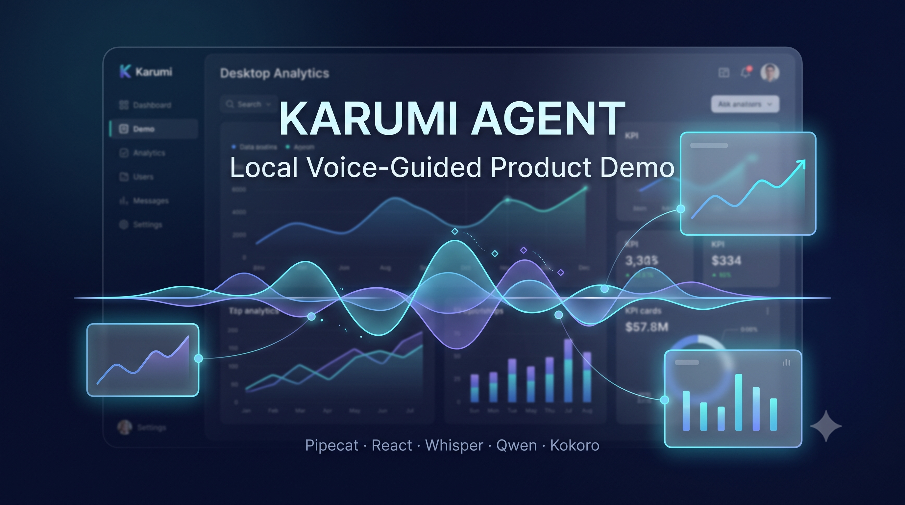

<p align="center">
  
</p>

# Karumi Agent

**Development period:** July 2026

## 1. Introduction

Karumi Agent is a local voice-guided demo of Metric Master Suite. It can hold a live conversation, present the product, and perform a deliberately small set of semantic actions in the connected React interface.

Pipecat manages the voice pipeline and WebRTC connection. Whisper, Qwen through Ollama, and Kokoro run locally, so the default setup does not require user-supplied API keys. React confirms each requested UI postcondition before the agent reports success.

## 2. How It Works

The browser and backend connect through SmallWebRTC. RTVI carries semantic UI state, commands, and results over the same session.

Explicit UI requests and guided-demo controls are resolved before Qwen. Normal product questions go to Qwen. For UI actions, the backend sends an allowlisted command with a unique `commandId`, waits up to five seconds for a coherent React result, and only then builds the spoken response.

## 3. Technology Stack

| Layer | Technology |
|---|---|
| Frontend | React 19.2.8 and Vite 8.1.5 |
| Voice pipeline | Pipecat 1.6.0 |
| Transport | SmallWebRTC and RTVI |
| Speech-to-text | Faster Whisper `base`, English, CPU `int8` |
| Language model | `qwen2.5:1.5b` through local Ollama |
| Text-to-speech | Kokoro ONNX, English `af_heart` voice |
| Python environment | Python 3.12 and `uv` |
| Node environment | Node 24 through `nvm`, with npm |

## 4. Requirements

Required:

- Python 3.12, selected by `.python-version` and managed through `uv`.
- Node 24, selected by `.nvmrc` and managed through Linux `nvm`.
- npm, Ollama, Git, and curl.
- A modern Chrome browser with a working microphone and audio output.
- Internet access for package installation, `ollama pull`, and the first Whisper and Kokoro model downloads.

A GPU is not required. Ensure the machine has enough available memory and storage to run Ollama, the Python voice models, Vite, and Chrome together.

## 5. Complete Setup

### System tools

Run from any directory on Ubuntu or WSL2:

```bash
sudo apt update
sudo apt install -y curl git
```

### Install uv

```bash
curl -LsSf https://astral.sh/uv/install.sh | sh
source "$HOME/.local/bin/env"
uv --version
```

### Install nvm

```bash
curl -o- https://raw.githubusercontent.com/nvm-sh/nvm/v0.40.6/install.sh | bash
source "$HOME/.nvm/nvm.sh"
command -v nvm
```

### Install Ollama

```bash
curl -fsSL https://ollama.com/install.sh | sh
ollama --version
```

### Clone the repository

```bash
git clone https://github.com/andresgilvicente/my-karumi-agent.git
cd my-karumi-agent
```

All remaining backend commands in this README run from the repository root unless stated otherwise.

### Install Python dependencies

```bash
uv sync
uv run python --version
```

`uv sync` creates or updates the local `.venv` from `pyproject.toml` and `uv.lock`.

### Install Node and frontend dependencies

```bash
source "$HOME/.nvm/nvm.sh"
nvm install
nvm use
command -v node
command -v npm
cd client
npm ci
cd ..
```

Under WSL2, both paths must point under `/home/...`, not `/mnt/c/...`.

### Download Qwen

```bash
ollama pull qwen2.5:1.5b
ollama list
```

The model list must contain `qwen2.5:1.5b`.

## 6. Run The Application

| Service | Default port | Purpose |
|---|---:|---|
| Ollama | 11434 | Local LLM runtime |
| Pipecat backend | 7860 | Voice pipeline and WebRTC runner |
| React frontend | 5173 | Main product demo |

> Open the main product demo at `http://localhost:5173`.

> `http://localhost:7860/client` is a voice-only diagnostic client. It is not the Metric Master Suite demo and cannot confirm product UI actions.

### Ollama

Check the local service and model:

```bash
curl http://localhost:11434/api/tags
ollama list
```

If the service is not running, start it in a separate terminal:

```bash
ollama serve
```

### Terminal 1: backend

From the repository root:

```bash
uv run bot.py -t webrtc
```

The Pipecat runner listens on `http://localhost:7860` by default. Its health endpoint is `GET /status`, its diagnostic client is under `/client`, and the React SmallWebRTC client posts offers to `/api/offer`.

The first browser connection can trigger Whisper or Kokoro downloads if their files are not cached yet.

### Terminal 2: frontend

From the repository root:

```bash
cd client
source "$HOME/.nvm/nvm.sh"
nvm use
npm run dev
```

Open `http://localhost:5173` in Chrome, click `Connect voice`, grant microphone permission, and speak in English.

If the backend intentionally uses another port, configure both processes consistently. For example:

```bash
# Terminal 1, repository root
uv run bot.py -t webrtc --port 7861

# Terminal 2, client/
VITE_PIPECAT_WEBRTC_URL=http://localhost:7861/api/offer npm run dev
```

### Important URLs

| URL | Purpose |
|---|---|
| `http://localhost:5173` | Main product demo; open this normally |
| `http://localhost:7860/status` | Backend health check |
| `http://localhost:7860/client` | Voice-only diagnostics |
| `http://localhost:11434` | Ollama service |

## 7. First Run

1. Confirm that Ollama is running and `qwen2.5:1.5b` is listed.
2. Start the backend from the repository root.
3. Start the frontend from `client/` with Node 24 active.
4. Open `http://localhost:5173` in Chrome.
5. Click `Connect voice` and allow microphone access.
6. Wait for Karumi Agent's introduction and tour offer.
7. Speak in English.

The first response may be slower while Qwen and local model files are loaded. Whisper and Kokoro can also download files on first use. An uncached first connection can exceed the frontend's 20-second readiness window; let the backend finish downloading and loading, then reconnect. Later turns may be faster, depending on the machine.

## 8. What The Agent Can Do

### Autonomous guided demo

After React publishes a compatible UI state, the agent introduces itself and offers a tour. If the user remains silent for five seconds after the introduction finishes, the agent starts an autonomous Dashboard → Analytics → Team sequence. Each step waits for React confirmation before its explanation.

The user can interrupt with a normal question without losing the next unvisited step. These exact controls are supported:

- `Pause the demo.`
- `Resume the demo.`
- `Continue.`
- `Stop the demo.`
- `Restart the demo.`

### Semantic navigation

Navigation uses named product views rather than coordinates or model-generated selectors. Dashboard centers and highlights Total Revenue, Analytics centers and highlights Traffic Overview, and Team centers the member list.

Supported examples:

- `Go to Dashboard.`
- `Can you please open Analytics?`
- `Take me back to Team.`
- `Could you navigate to Dashboard?`
- `Show me the Team section.`

### Panel focus

A focus request identifies the target's owner view, navigates when needed, centers the target, highlights it, waits for React confirmation, and then speaks.

| View | Supported targets |
|---|---|
| Dashboard | Total Revenue; Active Users; Dashboard Conversion Rate; Growth Rate; Performance Overview |
| Analytics | Page Views; Click-through Rate; Average Session Duration; Analytics Conversion Rate; Traffic Overview; Traffic Sources |
| Team | Team member list |

Supported examples:

- `Show me Total Revenue.`
- `Focus on Active Users.`
- `Highlight Performance Overview.`
- `Show me Traffic Overview.`
- `Focus on Traffic Sources.`
- `Take me to the team member list.`

### Team member search

Voice search uses the real Team filter. React filters the current in-memory member records and returns structured names and counts. The spoken response is built from that result; Qwen does not invent people.

| Case in the current mock data | Exact request | Expected result |
|---|---|---|
| No matches | `Is there anyone called Juan?` | Team opens and reports no matching member |
| One match | `Search for Olivia.` | Olivia Chen is filtered, centered, and highlighted |
| Multiple matches | `Search for Li.` | Olivia Chen, Liam Brown, and Noah Williams are reported from React's result |
| Clear filter | `Clear the search.` | All members return and the list is centered |

Other exact search forms include `Find a team member called Alex.` and `Does someone named Michael work here?`.

### Live conversation and interruptions

Normal product questions go to Qwen. The user can interrupt speech, ask a question during the tour, and continue afterward. The model is intentionally given a concise product context; it is not a general source of unlimited Metric Master Suite knowledge and unsupported phrasing is not guaranteed to become an action.

### Capability examples

| Kind | User phrase | Expected behaviour |
|---|---|---|
| Demo control | `Pause the demo.` | Pauses an active autonomous tour |
| Demo control | `Continue.` | Continues the pending tour step |
| Demo control | `Restart the demo.` | Restarts the tour from Dashboard |
| Navigation | `Go to Analytics.` | Opens Analytics, centers Traffic Overview, and highlights it |
| Navigation | `Take me back to Team.` | Opens Team and centers the member list |
| Focus | `Show me Active Users.` | Opens Dashboard, centers Active Users, and highlights it |
| Focus | `Focus on Traffic Sources.` | Opens Analytics, centers Traffic Sources, and highlights it |
| Search | `Search for Olivia.` | Opens Team and reports React's confirmed match |
| Search | `Clear the search.` | Clears the Team filter and restores the full list |
| Conversation | `What does this product do?` | Sends a normal question to Qwen without a UI action |

## 9. Recommended Demo Flow

### Three-to-five-minute flow

1. Start Ollama, the backend, and the frontend. Open `http://localhost:5173`.
2. Click `Connect voice`, allow the microphone, and remain silent through the offer until Dashboard starts.
3. Before automatic advancement, say `Pause the demo.`
4. Say `Show me Traffic Overview.` and then ask `What does this product do?`
5. Say `Resume the demo.` and let the controller continue from Analytics to Team.
6. Say `Search for Olivia.`, then `Clear the search.`, and then `Continue.`
7. Say `Restart the demo.`; after Dashboard returns, say `Stop the demo.`
8. Click `Disconnect`, reconnect in the same tab, and confirm that a fresh offer begins. Say `Not now.` to close it.

## 10. Environment Variables

No environment variable is required for the default local run.

| Variable | Required | Default | Purpose |
|---|---|---|---|
| `VITE_PIPECAT_WEBRTC_URL` | No | `http://localhost:7860/api/offer` | Alternative SmallWebRTC offer endpoint for the frontend |
| `KARUMI_DEBUG_LOGS` | No | Disabled | Enable detailed application logs when set to `true` |


## 11. Validation Commands

Backend, from the repository root:

```bash
uv run python -m unittest discover -s tests
uv run python -m py_compile bot.py ui_control/*.py
uv run python -c "import bot"
git diff --check
```

Frontend:

```bash
cd client
source "$HOME/.nvm/nvm.sh"
nvm use
npm ci
npm run build
```

## 12. Essential Troubleshooting

| Symptom | Likely cause | Action |
|---|---|---|
| `localhost:11434` refuses connections | Ollama is not running | Run `ollama serve`, or start its system service |
| Backend reports that the model is missing | Qwen has not been downloaded | Run `ollama pull qwen2.5:1.5b` |
| Browser has no microphone input | Site permission is blocked | Allow microphone access for `localhost` in Chrome and reconnect |
| npm prints Windows or UNC path errors in WSL | Windows Node/npm is ahead of nvm in `PATH` | Run `source "$HOME/.nvm/nvm.sh"`, `nvm use`, and confirm both paths are under `/home/...` |
| Backend cannot bind to 7860 | The port or another backend instance is in use | Stop the duplicate process or use `--port` and set the matching frontend URL |
| Vite prints a different URL | Port 5173 is already in use | Open the exact URL Vite prints, or free port 5173 before the demo |
| The first connection or response is slow | Qwen is loading, or Whisper/Kokoro files are downloading | Keep the process running and wait for the first load to finish |
| `GET /status` is unavailable | The Pipecat runner is not ready or exited | Inspect Terminal 1, fix its reported error, and restart the backend |
| React loads but voice does not connect | Backend URL mismatch or WebRTC runner unavailable | Check `/status` and the configured `/api/offer` URL, then reconnect |

## 13. Further Documentation

- [`PROJECT_JOURNEY.md`](PROJECT_JOURNEY.md): project history, decisions, problems, lessons, and future work.
- [`PROJECT_STATE.md`](PROJECT_STATE.md): current verified state, warnings, limitations, and pending manual checks.
- [`AGENTS.md`](AGENTS.md): architecture invariants and safe development instructions.
- [`docs/DEMO_SCRIPT.md`](docs/DEMO_SCRIPT.md): the presenter-facing three-to-five-minute and short demo flows.

