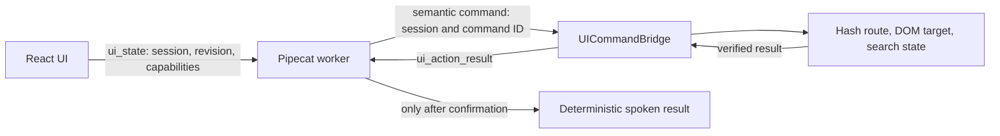
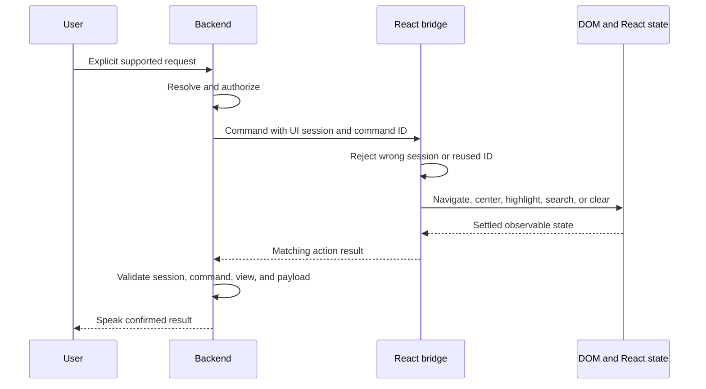
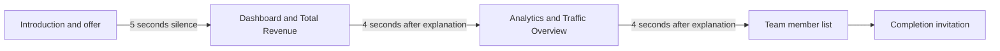

# 1 Project context and assignment

I developed this project as a local voice-guided product demonstration for Metric Master Suite, a representative SaaS analytics workspace. The assignment was not simply to put a chat interface next to a dashboard. The useful outcome was an agent that could talk about the product, move through a real interface, focus the user's attention, and conduct a short demonstration without claiming that something had happened before the browser had actually done it.

The repository began on 2026-07-27 with commit `962ff1b`, which contained the initial repository setup and a one-line README. Commit `dba9f1f` then established the first substantial product surface: a React and Vite mock, a minimal FastAPI health scaffold, Python and Node version constraints, and lockfiles. The project description in `pyproject.toml` already identified the intended product as a voice-guided demonstration of Metric Master Suite. The later history shows how that broad objective was converted into a connected, local, and confirmation-gated experience.

I treat four evidence classes separately in this account:

| Evidence class | Sources | How I use it |
|---|---|---|
| Current implementation | `bot.py`, `client/src/`, `ui_control/`, manifests | Source of truth for the final architecture and behavior |
| Automated behavior | `tests/`, build and runtime checks | Evidence for deterministic logic, contracts, state transitions, and buildability |
| Historical development | Git commits from `962ff1b` through `c7c805a` | Evidence for sequence, removed designs, and the reason a capability appeared |
| Manual behavior | Dated records in `PROJECT_STATE.md` and supplied validation notes | Evidence only for the exact dated flow that was exercised |

This distinction matters because voice applications combine code, local model behavior, browser media, timers, and user timing. A unit test can prove that a stale acknowledgement is rejected, but it cannot prove that a microphone, a current browser build, and the complete spoken flow work together. Conversely, a successful historical demonstration does not automatically validate later changes.

The assignment also allowed URL ingestion as optional scope. I did not implement it. Nothing in the current pipeline fetches, parses, indexes, or grounds answers in a user-supplied URL. The final product remains a focused demonstration over the product information and representative data encoded in the repository.

# 2 Original objective

My original objective was to produce a credible local product-demo agent rather than a general-purpose assistant. The initial voice implementation in commit `deec810` made that role explicit in its system instruction: Karumi Agent was an English-speaking AI Product Demo Specialist for Metric Master Suite, expected to introduce the product, answer concise questions, and invite interruption. At that stage it also explicitly said that interface control was not connected, which accurately described the first milestone and prevented false claims.

The objective had four practical dimensions.

| Dimension | Intended outcome | Final evidence |
|---|---|---|
| Product experience | A polished, navigable SaaS mock rather than an empty technical client | Home, Dashboard, Goals, Analytics, and Team views in `client/src/App.jsx` with responsive styling in `App.css` |
| Voice loop | Local speech recognition, language-model response, and speech synthesis | Pipecat pipeline using Whisper, Ollama, Kokoro, and SmallWebRTC in `bot.py` |
| Grounded UI control | Semantic actions whose success depends on browser confirmation | RTVI `ui_state`, `RTVIUICommandFrame`, and `ui_action_result` handling across `bot.py` and `UICommandBridge.jsx` |
| Demonstration behavior | A proactive, interruptible tour rather than only reactive commands | Declarative Dashboard to Analytics to Team controller in `ui_control/guided_demo.json` and `guided_demo.py` |

The strongest interpretation of success was therefore end-to-end coherence. A user should be able to connect voice, hear a short introduction, request a supported screen or panel, watch the interface settle and focus, and hear a response based on a confirmed result. For the autonomous path, silence should allow the tour to proceed, while user speech and explicit controls should affect deterministic tour state rather than leaving that state to the language model.

The objective was deliberately narrower than building a production analytics platform. The data could be representative and in memory. The agent did not need arbitrary browser control. The UI did not need to expose every visible control to voice. This focus made it possible to spend development effort on turn handling, acknowledgement integrity, session isolation, and interruption behavior, which are the parts most likely to undermine trust in a live voice demonstration.

# 3 Scope definition

I defined the implemented scope around one vertical demonstration path. The browser and voice worker had to form one connected product rather than two independent demos, but the semantic control surface remained allowlisted.

## Included scope

| Area | Implemented scope |
|---|---|
| Frontend | Responsive React product mock with `#home`, `#dashboard`, `#dashboard-goals`, `#analytics`, and `#team` hash routes |
| Voice | English microphone input and audio output over SmallWebRTC |
| Local AI | Whisper `base` speech recognition on CPU with `int8`, Ollama `qwen2.5:1.5b`, and Kokoro voice `af_heart` |
| Product conversation | Concise responses about the representative Metric Master Suite content |
| Navigation | Dashboard, Analytics, and Team |
| Focus | Twelve catalog targets across those three supported views |
| Team operations | Search over the same in-memory predicate used by the rendered table, plus clear search |
| Guided demo | Proactive offer and deterministic Dashboard, Analytics, Team sequence with start, continue, pause, resume, stop, and restart controls |
| Diagnostics | Readable logs, Pipecat latency observers, and opt-in local JSONL profiling |

The twelve focus targets are five Dashboard elements, six Analytics elements, and the Team member list. Dashboard exposes Total Revenue, Active Users, Dashboard Conversion Rate, Growth Rate, and Performance Overview. Analytics exposes Page Views, Click-through Rate, Average Session Duration, Analytics Conversion Rate, Traffic Overview, and Traffic Sources. Team exposes the member list. The duplicated Conversion Rate label is resolved against an explicitly named view or the current view; ambiguity is rejected rather than guessed.

## Deliberately excluded scope

| Area | Status |
|---|---|
| URL ingestion | Optional assignment scope, not implemented |
| Goals voice control | Not in the semantic catalog, although the tab remains available manually |
| Analytics tab control | Not implemented |
| Coordinates and directional scrolling | Not implemented |
| Generic DOM or screen control | Not implemented |
| UIWorker | Not implemented |
| Persistence and a product data API | Not implemented |
| Authentication and multi-user behavior | Not implemented |
| Deployment | Not implemented |
| Browser end-to-end automation | Not implemented |

This boundary is visible in `client/src/ui-demo-catalog.json`. The catalog describes only the supported semantic surface, not all routes, data, or DOM nodes. Unknown UI actions are rejected, unavailable capabilities block dispatch, and unsupported requests remain conversational rather than being converted into an unsafe generic command.

# 4 Initial technical decisions

The first technical baseline was established in commit `dba9f1f`. I used React 19 and Vite for the product mock, JavaScript and a single CSS layer for the frontend, Python 3.12 for the application worker, and independent npm and uv dependency boundaries. The frontend deliberately stayed small: `App.jsx` owned the static data, components, interactions, and hash routing, so there was no router package, API client, data layer, or persistence layer to maintain for the demonstration.

That commit also introduced a minimal FastAPI application with one health endpoint. It was a scaffold rather than the eventual transport architecture. Commit `deec810` removed `server.py` and replaced the FastAPI dependencies with Pipecat's runner, WebRTC, Whisper, and Kokoro support. From then on, `bot.py` became the only application-owned Python entry point. React ultimately connected directly to the Pipecat SmallWebRTC runner, so the final application has no separate service on the former application port.

The initial local voice stack was:

| Stage | Decision | Current retained setting |
|---|---|---|
| Transport | Pipecat runner with SmallWebRTC | Audio input and output enabled |
| Speech recognition | Local Whisper | `base`, English, CPU, `int8` |
| Language model | Local Ollama | `qwen2.5:1.5b`, temperature 0.3, maximum 150 tokens |
| Speech synthesis | Local Kokoro | `af_heart`, English, 24 kHz output |
| Turn start | Silero VAD | VAD start strategy |
| Turn end | Speech timeout | 1.0 seconds |

The local-first decision is evidenced by the dependency manifests and current runtime. The application itself does not require hosted model services or credentials. This kept the product demonstrable on one machine and made the profiling data local, but it also tied the experience to CPU inference, local model availability, browser media support, and system prerequisites such as the Kokoro phonemizer.

The early frontend made several decisions that remained useful when voice was connected. Hash routes gave the bridge stable semantic destinations without a router dependency. Product panels received stable IDs that could later become allowlisted targets. Dashboard tabs included keyboard behavior, team filtering used a single reusable predicate, and the CSS included responsive layouts and reduced-motion behavior. These were not yet voice features, but they provided concrete interface state for the later command contract.

# 5 Development stages

The Git history records a sequence of small architectural milestones rather than one large implementation. The following chronology uses the verified commit order and current diffs.

| Date | Commit | Stage and observable result |
|---|---|---|
| 2026-07-27 | `962ff1b` | Initialized the repository with ignore rules and the initial README |
| 2026-07-27 | `dba9f1f` | Added the React and Vite product mock, a minimal FastAPI health scaffold, manifests, lockfiles, and runtime version files |
| 2026-07-27 | `deec810` | Added the fully local Pipecat, Whisper, Ollama, and Kokoro voice pipeline and removed the application FastAPI server |
| 2026-07-27 | `2c526b5` | Added the first architecture and project-state handoff documentation, explicitly recording that voice and React were still disconnected |
| 2026-07-28 | `00eb1ca` | Stabilized turn completion around a 1.0-second speech timeout and added native stage and end-to-end latency observation |
| 2026-07-28 | `f9d20d2` | Connected React directly to the voice worker, added voice controls, semantic commands, browser acknowledgements, and deterministic explicit-action dispatch |
| 2026-07-28 | `9c059c3` | Extracted the shared versioned UI catalog and Python control modules, then introduced the standard-library UI-control test suite |
| 2026-07-28 | `902214e` | Added sentence-level Markdown filtering before Kokoro synthesis and focused filter tests |
| 2026-07-28 | `d3da946` | Separated readable conversation logs from debug metrics and guarded empty browser ICE end-of-candidates messages |
| 2026-07-28 | `5f200cd` | Added opt-in correlated JSONL profiling and a fixed profiling corpus and protocol |
| 2026-07-28 | `a071666` | Added the declarative autonomous guided demo, deterministic controls, playback-aware timers, interruption recovery, and guided-demo tests |
| 2026-07-28 | `05f2cff` | Enriched and stabilized reconnects, session isolation, centering, twelve focus targets, view-aware ambiguity handling, Team search, and tour synchronization |
| 2026-07-28 | `756c041` | Added clear Team search and advanced the shared UI contract to version 4 |
| 2026-07-29 | `c7c805a` | Updated the mock user profile and made the Analytics date range explicit |
| 2026-07-29 | Current final work | Fixed clear-search acknowledgement validation, added clear-specific stale-session regression coverage, synchronized a confirmed clear with the Team tour position, and corrected fallback phrase ordering so informational questions are not treated as commands |

## Stage 1: product and local voice foundations

The first substantial milestone produced two independent surfaces. React provided the product experience, while `bot.py` provided a standalone local conversation. Commit `2c526b5` accurately documented the gap: there was no command contract and no mechanism for the agent to navigate the mock. This was a useful boundary because the voice agent still explicitly disclaimed screen control.

## Stage 2: turn stabilization and connection

Commit `00eb1ca` made end-of-turn behavior explicit and observable before UI integration. Commit `f9d20d2` then connected the surfaces through the protocol already carried by Pipecat. React published state and handled commands; the backend sent a unique command identifier and waited up to five seconds for a result. Explicit supported requests were intercepted before the LLM, while normal conversation still went through Ollama.

## Stage 3: contract extraction and safety

Commit `9c059c3` moved command descriptions, view mappings, target aliases, and success copy into `client/src/ui-demo-catalog.json`. Python loaded and validated that same file. This reduced drift between browser capabilities, resolver behavior, and tool schemas. It also created a natural test boundary around catalog validation, intent resolution, serialized execution, failure responses, and deterministic context recording.

## Stage 4: voice quality and observability

Commits `902214e`, `d3da946`, and `5f200cd` addressed problems that become visible only in a spoken system: formatting tokens reaching speech, noisy logs hiding the conversational trace, WebRTC end-of-candidates noise, and insufficiently correlated timing data. The profiler was deliberately opt-in and local. The fixed corpus defined how a future comparison should be run, but its existence is not evidence that every proposed comparison was actually performed.

## Stage 5: autonomous demonstration

Commit `a071666` added a backend-owned tour with a closed state machine. It did not ask Qwen to decide the next screen. Instead, JSON defined the copy and timing, the controller owned state, the existing executor performed actions, and playback observers scheduled time from actual speech completion. Commit `05f2cff` then dealt with interaction between the tour and direct commands, reconnection, duplicate labels, broader focus, and Team search. Contract version 4 added clear search, and the final current work closed acknowledgement and synchronization gaps around that new command.

# 6 Architecture evolution

The architecture passed through three clear forms.

| Phase | Shape | Main limitation removed by the next phase |
|---|---|---|
| Scaffold | React mock plus minimal FastAPI health service | No voice pipeline |
| Parallel prototypes | React mock plus standalone Pipecat voice worker | No shared state or UI command path |
| Connected product | React and Pipecat joined directly through SmallWebRTC and RTVI | Current final architecture |

Removing the application FastAPI scaffold did not remove HTTP entirely. Pipecat's runner supplies the WebRTC offer endpoint, status endpoint, and its own test client. The distinction is that there is no separate application-owned API server or product-data backend. The browser connects to the runner's offer endpoint and exchanges media and RTVI messages with the worker.

The final processing order is explicit in `bot.py`:

```mermaid
flowchart LR
    MIC[Browser microphone] --> IN[SmallWebRTC input]
    IN --> STT[Whisper STT]
    STT --> DEMO[Guided-demo control gate]
    DEMO --> INTENT[UI intent and tool-choice gate]
    INTENT --> USER[User context aggregator]
    USER --> LLM[Ollama Qwen]
    LLM --> TTS[Kokoro TTS with Markdown filter]
    TTS --> OUT[SmallWebRTC output]
    OUT --> AUDIO[Browser audio]
    AUDIO --> ASSISTANT[Assistant context aggregator]
```

The guided-demo and UI-intent gates sit before the user context aggregator and Ollama. This ordering allows a closed demo control or an explicit supported UI request to be consumed deterministically. A normal question passes through both gates and reaches the LLM. The function schemas remain available as a narrow fallback, but they do not expand the allowlist.

The control plane runs alongside the audio path:

The shared catalog is the contract joining these surfaces. React imports it to advertise commands, views, and targets and to map semantic identifiers to routes and elements. Python loads and validates the same JSON to authorize actions, resolve phrases, build function schemas, run presentation sequences, and verify results. Contract version 4 currently defines five client commands plus the backend-composed `focus_target` action.

The guided demo is a separate orchestration layer rather than another command implementation. `guided_demo.json` declares the sequence and speech. `GuidedDemoController` owns session-local state and timers. `GuidedDemoProcessor` consumes only the exact closed control phrases. `UIActionExecutor` remains the one route to the browser, so the tour cannot bypass catalog authorization, serialization, session checks, timeouts, or acknowledgements.

# 7 Major decisions and trade-offs

## Local models rather than hosted inference

I retained local Whisper, Ollama, and Kokoro throughout the final architecture. The clear advantages are a self-contained demonstration, local transcript processing, and no hosted-service dependency in normal operation. The trade-offs are visible in the project records: CPU inference has variable latency, model processes and speech prerequisites must be present, Whisper can misrecognize product vocabulary, and Kokoro can dominate response time for longer answers.

## Deterministic actions before generative conversation

The most consequential control decision was to dispatch explicit supported actions deterministically before Ollama. Historical development records captured the concrete failure mode: the configured 1.5B model could narrate an action even when a tool was required. A demo cannot treat persuasive text as evidence that the screen changed. The deterministic resolver therefore recognizes a deliberately bounded phrase set, while Ollama remains responsible for normal explanations and questions.

This creates a deliberate trade-off. The control path is auditable, fast to test, and unable to invent a command, but it understands fewer paraphrases than a stronger semantic model might. The limited function-tool fallback preserves some flexibility without weakening the browser allowlist or acknowledgement checks. Current logs and profiles distinguish `deterministic`, `function_call`, and `conversation` paths so that the behavior is observable.

## Semantic identifiers rather than generic browser control

Commands use identifiers such as `analytics`, `traffic-overview`, and `team-member-list`, not coordinates or model-generated selectors. React remains responsible for translating those identifiers into routes and elements. This restricts the surface, but it makes commands reviewable and keeps DOM implementation details out of model output. It also permits the browser to verify that the expected route and target are still present before returning success.

## Confirmation before success language

Every UI action waits for a matching result. The backend checks the active UI session, command name, expected view, and expected target or search payload before converting `status: ok` into `status: confirmed`. This costs a round trip and can produce a five-second timeout, but the alternative would allow the agent to speak an unverified success. The project consistently chose trustworthiness over optimistic narration.

## Backend-owned guided state rather than LLM-owned choreography

The guided demo is deterministic because tour state has timing and concurrency requirements that conversational generation does not satisfy by itself. Qwen can answer a question during the tour, but it does not choose whether the tour is paused, which step is confirmed, or what screen comes next. The cost is a more explicit state machine. The benefit is that transitions, timers, interruption recovery, and failure behavior can be tested as state rather than inferred from generated text.

## Playback boundaries rather than queue time

The tour starts its five-second offer timer after the introduction has actually stopped playing, and its four-second intervention window after a step explanation has stopped playing. `GuidedDemoPlaybackObserver` forwards `BotStartedSpeakingFrame` and `BotStoppedSpeakingFrame` to the controller. This is more complex than sleeping after speech is queued, but queue time is not what the user experiences, especially with variable local synthesis latency.

## Small frontend architecture rather than premature application layers

The final frontend still keeps routes, data, views, and most interactions in `App.jsx`. This limits modularity as the mock grows, but it avoids adding a router, API layer, or persistence abstraction that the current static demonstration does not need. The voice boundary was extracted where reuse and correctness justified it: connection behavior lives in `VoiceControls.jsx` and `voiceClient.js`, while the command contract lives in `UICommandBridge.jsx` and the shared catalog.

## Declarative catalogs and copy

Both the UI surface and guided sequence are data-driven. This added validation code, but it removed repeated command definitions from Python and React and made version changes explicit. It also let tests iterate over all declared targets and steps. The contract remains intentionally semantic and small rather than becoming a complete representation of the application.

# 8 Problems and debugging

## Turn completion and latency visibility

The first local pipeline used the default aggregation behavior and a simple transcription-to-first-token timer. Commit `00eb1ca` made the turn start and stop strategies explicit and added Pipecat observers for end-to-end and per-service timing. The retained baseline is Whisper `base` with a 1.0-second speech timeout. Historical documentation from 2026-07-28 reports final transcription approximately 1.4 to 2.3 seconds after clean warm speech ended, one Dashboard turn reaching first bot audio in 4.284 seconds, and longer responses taking 8 to 18 seconds before first audio, with Kokoro accounting for most of that delay in those observations.

The same historical record reports recognition errors for product-specific vocabulary. This explains why the semantic resolver includes bounded aliases and limited short-term transcript continuation. It does not establish that every proposed Whisper model or timeout combination was tested.

## Unreliable tool selection by the compact LLM

When the browser was first connected, relying only on the language model to call a required tool was not reliable enough. The documented failure mode was narration without execution. The fix was architectural: supported explicit requests are resolved before the model, executed through the acknowledgement-aware executor, and answered with deterministic copy. Normal informational language still goes to Ollama.

The final current work corrected a subtle ordering issue in the fallback. A phrase such as "What can Dashboard show me?" contains both a view name and words that also occur in navigation phrases. The fallback now requires the action phrase to appear before the requested view or target. Tests verify that informational Dashboard, Analytics, Team, and "Tim" questions do not navigate.

## Spoken Markdown markers

The system instruction asks Qwen for plain sentences, but generated formatting cannot be treated as impossible. Commit `902214e` inserted Pipecat's `MarkdownTextFilter` into Kokoro's text path. Tests cover bold, italic, underscore, inline-code, and unchanged plain speech. Filtering at the TTS boundary preserves the model response while preventing formatting syntax from being pronounced.

## WebRTC end-of-candidates noise

Chrome can emit an end-of-candidates object with an empty candidate string. Commit `d3da946` added `SafeSmallWebRTCTransport`, which ignores that empty marker before the parent transport attempts to send it. This is a narrow compatibility guard rather than a replacement transport.

## Stale sessions and reconnect races

Once the interface and worker were connected, command completion could overlap disconnects or replacement sessions. Commit `05f2cff` introduced a frontend UI session nonce, backend session generations, pending-action cleanup, a serialized connection operation, and a one-second disconnect-settling window. The browser also records processed command IDs so duplicate delivery returns the same result, while reuse of one ID for a different request is rejected.

The tests exercise stale state revisions, session replacement, late confirmations, generation changes during multi-action sequences, and pending-action settlement. Current manual repeated-reconnect validation is still pending, so these are strong logic checks rather than a claim about the present browser environment.

## Target ambiguity and physical presentation

Expanding from three default targets to twelve introduced duplicate human labels, especially Conversion Rate on both Dashboard and Analytics. The resolver uses an explicit view qualifier when present, otherwise the current view, and rejects unresolved multi-target requests. The executor also changed focus into a sequence: navigate if needed, center, then highlight. React verifies the final route and centering tolerance before acknowledging.

## Team search and clear acknowledgement

Team search had to return browser-derived facts, not model guesses. React applies the same `filterTeamMembers` predicate used to render the table and returns the query, match count, and names. Python validates their types and consistency before speaking the result.

Contract version 4 added `clear_team_search`, but the first committed backend confirmation matcher did not have a dedicated success branch for that command. The current final work fixes this by requiring the Team page and `cleared: true`, and by rejecting stale-session clear results. It also notifies the guided-demo controller that a confirmed clear action places the interface in Team, keeping the tour's next-step state synchronized.

## Evidence boundaries

Some plausible development stories are not supported by this repository. I found no verified Smart Turn experiment, no recorded duplicated-prompt incident, no completed model bake-off, and no UIWorker implementation. A historical README proposes Whisper and timeout comparisons, but a proposal is not an experiment result. I therefore do not use those items to explain implemented changes.

# 9 Reliability design

Reliability in this project means more than avoiding exceptions. It means keeping speech, browser state, conversation context, tour state, and connection identity consistent under delayed or repeated events.

## Contract and capability checks

React publishes a versioned `ui_state` containing a per-connection `uiSessionId`, a monotonic revision, current page, selected tab, visible elements, and supported commands, views, and targets. Python requires contract version 4 and all catalog-required capabilities. Extra frontend capabilities are allowed, but missing or malformed capability lists make the contract incompatible. State revisions that do not advance within the same UI session are ignored.

Authorization is checked again for every action. A compatible catalog as a whole is not enough; the requested command, view, and target must all be advertised. This keeps the backend authoritative about the allowlist while still requiring the connected browser to declare what it can execute.

## Correlated acknowledgement sequence

The backend gives each command a unique ID and binds its pending future to the active UI session and backend session generation. It waits at most five seconds. A disconnect, replacement session, timeout, command error, mismatched result, or generation change produces an error path. Late and unknown results do not complete a new action.

On the frontend, `runCommand` is idempotent by command ID. Concurrent delivery of the same request shares one promise and replays one result. Reusing an ID with a different request returns an error. A session epoch prevents a result from being emitted after disconnect. Navigation waits for the hash, destination element, two animation frames, and top-of-page settlement. Centering waits for scrolling and verifies a tolerance. Highlighting verifies that the element remains connected.

## Serialized compound actions

`UIActionExecutor` uses one asynchronous lock. Navigation and focus can involve several browser commands, so direct user commands and tour actions cannot interleave those sequences. The executor checks the expected session generation before and after every send. It stops at the first failure and records whether navigation itself was already confirmed, allowing the controller to distinguish a fully failed action from a screen that changed but did not finish its presentation.

## Context-safe deterministic turns

A deterministic request is consumed before Ollama, but it still belongs in conversation history. `record_deterministic_turn` adds the user's text and the deterministic response to `LLMContext` before queuing a `TTSSpeakFrame` with context appending disabled. This prevents duplicate context and preserves the confirmed fact even if playback is interrupted.

`ConsumedUserTurnFrame` and `ConsumedUserTurnStopStrategy` close a consumed turn without forwarding it as an LLM request. Generation correlation prevents an old finalizer from closing a newer utterance. Tests cover an overtaking transcript and retry behavior, which is important because rapid speech can reorder VAD, transcription, and finalization events.

## Guided-demo generations and playback state

The tour controller has explicit states from idle and offered through running, waiting, answering, paused, completed, cancelled, and failed. Timer and action tasks carry a controller generation. Restart, stop, or disconnect invalidates that generation and cancels pending work. User speech immediately cancels auto-advance. If an action confirms while the user is speaking, the explanation is deferred rather than the action being repeated.

The tour only advances after confirmed actions. Failure stops the sequence and produces failure copy, either immediately or after an in-progress answer. External navigation, focus, Team search, and clear search synchronize the current tour view only after a confirmed or partially screen-confirmed result. An explicit navigation while the initial offer is pending opts out of proactive advancement.

# 10 Latency and performance

Voice latency is not one number. The current observers separate startup from user turns and expose several stages:

| Metric | Meaning |
|---|---|
| Client connected to first bot audio | Cold introduction path, including startup work |
| Speech end to transcription | Recognition completion after the user stops |
| Speech end to logical turn close | End-of-turn policy cost |
| STT processing | Native Whisper service processing metric |
| LLM processing | Native Ollama service processing metric |
| TTS time to first audio | Kokoro's first-audio generation delay |
| TTS processing total | Accumulated synthesis time across response segments |
| Speech end to first bot audio | Primary perceived warm-turn metric |
| UI acknowledgement | Browser command round trip and presentation settlement |

The dated 2026-07-28 measurements are useful historical observations, not a complete benchmark:

| Historical observation | Recorded value |
|---|---|
| Clean warm final transcription after speech end | Approximately 1.4 to 2.3 seconds |
| One Dashboard speech-end-to-first-audio turn | 4.284 seconds |
| Longer response speech-end-to-first-audio | 8 to 18 seconds |
| Main variable contributor in those longer turns | Kokoro generation |

Commit `5f200cd` improved the quality of future evidence. The profiler correlates run, session, turn, transcription, resolution path, service metrics, first audio, UI outcomes, interruption, and summary records in local JSONL. `docs/profiling-corpus.md` fixes the phrases, execution order, warm and cold treatment, and reporting rules. It explicitly asks for medians, highest usable values, and separate failures. I regard that as profiling infrastructure and protocol, not proof that a complete fixed-corpus baseline or model comparison was collected.

The retained runtime settings also express latency trade-offs. A 1.0-second speech timeout adds deliberate silence but reduces the chance of splitting a natural pause. The LLM is limited to 150 tokens and instructed to answer in two or three concise sentences. Deterministic UI turns avoid model generation for the response itself, but they still wait for real browser presentation and acknowledgement.

The preliminary Vite 8.1.5 build on 2026-07-29 completed with a 678.94 kB JavaScript chunk and the known advisory for chunks over 500 kB. That number is contextual build output, not a measured browser load-time result. Earlier dated repository records show the advisory already existed as the voice and demo dependencies were added. No bundle optimization or user-performance claim has been validated.

# 11 Final product

The final product is one local, connected demonstration with a polished React interface and a Pipecat voice worker. The browser provides the product UI, microphone controls, activity state, audio playback, semantic command handlers, and acknowledgements. The worker provides turn handling, product conversation, deterministic UI resolution, action sequencing, the autonomous tour, local model services, and diagnostics.

A typical supported direct interaction is:

1. The user opens the React application and selects `Connect voice`.
2. React and the worker establish SmallWebRTC, and React publishes a fresh version 4 UI state.
3. The agent offers a short interactive tour once the UI contract is compatible.
4. The user can ask a product question, request a supported view, focus a supported panel, search Team, or use a tour control.
5. A deterministic action is serialized, sent with session and command identifiers, performed and checked by React, and validated again by Python.
6. Only then does the agent speak the result or explanation.

The direct semantic surface is summarized below.

| View | Default navigation presentation | Additional supported focus |
|---|---|---|
| Dashboard | Open Overview, center and highlight Total Revenue | Active Users, Dashboard Conversion Rate, Growth Rate, Performance Overview |
| Analytics | Open Analytics, center and highlight Traffic Overview | Page Views, Click-through Rate, Average Session Duration, Analytics Conversion Rate, Traffic Sources |
| Team | Open Team and center the member list | Member-list focus, member search, and clear search |

Search results are grounded in the eight representative members in `App.jsx`. The browser returns zero, one, or multiple matching names and counts; deterministic response copy changes accordingly. Clear search restores the full list and centers it. Goals remain visible and keyboard-accessible as a manual Dashboard tab but are deliberately absent from the voice contract.

The autonomous path is a three-step tour:

The transition and explanation for each step are declared in `guided_demo.json`. The user can interrupt with a question, use exact allowlisted controls, or issue a direct supported action. Silence resumes progression only after playback finishes and the intervention window expires. Restart resets the sequence to Dashboard. A failed presentation stops the tour instead of narrating success.

The UI itself remains a representative product mock. It includes responsive Home, Dashboard, Analytics, and Team layouts, accessible labels and live search status, keyboard-operated Dashboard tabs, a skip link, reduced-motion behavior, and visible voice connection state. Commit `c7c805a` updated the displayed user to Andrés Gil, AI Engineer, and made the Analytics period `Jun 28 - Jul 27, 2026`.

# 12 Validation

Validation must be read in three layers: current preliminary automated and service checks, historical manual evidence, and unexecuted current browser checks.

## Preliminary current validation on 2026-07-29

| Check | Result |
|---|---|
| `uv sync` | Passed |
| Python byte-compilation of `bot.py` | Passed |
| Python import | Passed |
| Standard-library test discovery | 76 tests passed |
| `npm ci` | Passed with 0 vulnerabilities reported |
| Vite 8.1.5 production build | Passed |
| Current generated JavaScript chunk | 678.94 kB, with the known over-500 kB advisory |
| Pipecat runner status | HTTP 200 and ready at port 7860 |
| Frontend service | HTTP 200 at port 5173 |
| Ollama runtime | Version 0.32.4 available |
| Configured `qwen2.5:1.5b` model | Responded successfully |

The 76 tests cover catalog integrity and malformed contracts, deterministic and fallback intent resolution, every UI/control showcase phrase published in the README, demo script, and final checklist, split commands, all twelve targets, Conversion Rate disambiguation, serialized multi-step execution, failure stopping, deterministic context recording, Markdown filtering, Team search and clear behavior, session replacement, stale acknowledgements, guided-demo definitions and controls, silence-based advancement, playback timing, interruptions, action races, restart and synchronization, disconnect cleanup, consumed-turn generation behavior, and opt-in profiling records. They do not exhaustively assert every profiling-corpus utterance or validate live STT recognition.

These tests are valuable because they exercise the stateful core without loading a browser or running speech models. They do not simulate the DOM, WebRTC media, actual microphone input, audible playback, browser scrolling, or real reconnect timing.

## Historical manual evidence from 2026-07-28

The following evidence is historical and applies to the implementation exercised on that date:

| Historical manual flow | Recorded outcome |
|---|---|
| React connected to the Pipecat worker and published initial UI state | Passed |
| Normal voice exchanges | Passed |
| Team navigation and member-list scroll | Passed |
| Dashboard navigation and Total Revenue focus | Passed |
| Analytics navigation and Traffic Overview focus | Passed |
| Matching command acknowledgement before reporting initial navigation success | Observed in backend logs |
| One complete silent Dashboard to Analytics to Team tour and completion message | Passed |

This history demonstrates that the core design worked in Chrome on 2026-07-28. It does not substitute for rerunning the final version after reconnect, search, clear, session, resolver, and tour-synchronization changes.

## Current manual validation status

No Linux Chrome installation was available for the current 2026-07-29 validation. I therefore do not claim current manual validation of repeated reconnects, clear search, all twelve targets, Team search with zero, one, and multiple matches, tour controls, interruptions, or confirmation-before-speech ordering. Those remain explicit current validation gaps even though their deterministic logic has automated coverage.

A complete current browser pass should follow `docs/guided-demo.md` and verify those behaviors through the React application, because Pipecat's standalone test client cannot acknowledge Metric Master Suite UI commands.

# 13 Known limitations

The final implementation is intentionally an MVP and has several clear limits.

| Limitation | Practical consequence |
|---|---|
| Static representative data | Product metrics and team members do not come from a live system |
| No persistence or product data API | Refreshing or restarting does not preserve application changes |
| No authentication or multi-user design | The demo is not suitable as a shared production service |
| No deployment configuration | Operation is documented for a local machine only |
| No URL ingestion | The agent cannot build a demo or answer from a supplied web page |
| Narrow semantic allowlist | Goals, analytics tabs, arbitrary controls, coordinates, and directional scrolling remain unsupported |
| Closed phrase resolution | Unlisted paraphrases can remain conversational instead of triggering an action |
| Segmented Whisper output | The pipeline waits for completed utterances rather than streaming partial transcripts |
| Fixed speech timeout | Natural pauses can still split a turn; shorter latency is traded against safer completion |
| Product vocabulary recognition | Local Whisper can misrecognize names documented in the project history |
| Variable local synthesis | Longer Kokoro responses can increase time to first audio |
| Fixed guided-demo cadence | Five-second offer, four-second intervention, and five-second transcript-recovery values have not been tuned through a complete current manual matrix |
| No browser end-to-end suite | DOM, media, scrolling, and playback integration require manual validation |
| Large frontend chunk advisory | The production build passes but reports a 678.94 kB current chunk |

UIWorker is not part of the implementation. The worker is the Pipecat voice application in `bot.py`, and the React bridge executes the allowlisted UI commands. Any future UIWorker design would be a new architecture, not a hidden or partial current capability.

The current final work improves clear acknowledgement, tour synchronization, malformed capability handling, and informational fallback ordering, but the absence of current Chrome validation remains important. Automated state-machine tests reduce risk; they do not prove visual centering, highlight perception, microphone recovery, or audible ordering on the target browser.

# 14 What I would do with more time

My first priority would be evidence, not feature expansion.

1. I would run the complete current Chrome matrix for repeated reconnects, all twelve targets, zero, one, and multiple Team search matches, clear search, every tour control, interruptions at each playback boundary, disconnect during pending work, and confirmation-before-speech ordering.
2. I would add browser end-to-end automation around the semantic command bridge. The tests should use the real React build and assert route, center, highlight, search state, idempotency, and emitted acknowledgement payloads. Media and local-model checks could remain a smaller manual smoke layer if full audio automation proved disproportionate.
3. I would collect the fixed profiling corpus exactly as documented before changing runtime settings. Only then would I compare one variable at a time, such as an end-of-turn strategy, Whisper configuration, language model, response length, or TTS option. There is no verified model bake-off in the current history, so that work would begin from a new measured baseline.
4. I would investigate product-vocabulary handling and turn completion without assuming a particular solution. Any alternative would need to improve recognition or pause handling without weakening interruption behavior or adding unjustified latency.
5. I would reduce the frontend bundle and measure actual loading impact. Possible code splitting should be driven by build analysis and browser measurements rather than the advisory alone.
6. I would implement optional URL ingestion only if it became a real demonstration requirement. It would need content retrieval, parsing, grounding, source limits, failure behavior, and clear separation from UI commands; simply adding fetched text to a prompt would not be sufficient.
7. If the mock became a real product, I would add a backend data model, persistence, authentication, authorization, multi-user session ownership, and deployment configuration. These concerns should not be retrofitted invisibly into the current local demo.
8. I would evaluate UIWorker only as a future architectural option if the command surface grew beyond this compact catalog. Any such design should preserve semantic allowlists, per-session identity, idempotency, and confirmation before success language.

I would resist expanding voice control to every visible element until a concrete use case justified it. The current value comes from a reliable vertical narrative, not from the number of commands. Additional capabilities should enter through the same catalog, validation, acknowledgement, and test path.

# 15 Lessons learned

The main lesson is that a voice-controlled product demo is a distributed state system even when it runs on one computer. Audio, transcription, model generation, browser rendering, timers, and user interruption all progress independently. Treating the project as "an LLM with a few tools" would have missed the most important failure modes.

I learned that confirmation is a product behavior, not only a protocol detail. A spoken assistant creates a strong impression of success. The implementation therefore has to earn the right to say "open," "centered," "highlighted," "found," or "cleared." Matching the browser result against session, command, view, target, query, and count made the demonstration more trustworthy than optimistic tool narration.

I also learned that deterministic and generative behavior work best when each owns the part it can handle reliably. The deterministic resolver and tour controller own finite state and allowlisted actions. Ollama owns concise explanations and open product questions. This division avoids asking a compact local model to perform orchestration while still preserving a natural conversational layer.

The shared catalog demonstrated the value of one semantic contract. Before extraction, view names, aliases, targets, and action schemas were repeated. After extraction, React capability publication, Python authorization, tool generation, resolver aliases, presentation actions, success copy, and iterative tests could refer to the same versioned data. Declarative configuration did not remove logic, but it made drift visible and testable.

Playback-aware timing was another important lesson. Scheduling from the moment speech is queued ignores synthesis and output delay. The user experiences the end of audible speech, so the tour's silence windows must begin there. The same principle applies to UI actions: queue completion is not visual completion, which is why React waits for settled routes, elements, scroll position, and highlight application.

Session generations and idempotency became essential as soon as reconnect was possible. A correct result from an old session is incorrect for the new one. The combination of backend generation counters, frontend UI session nonces, command IDs, pending-future cleanup, and replay-safe handlers is more robust than trying to infer freshness from timing.

Finally, I learned to separate evidence from plans. The repository contains proposed experiments, profiling infrastructure, unit tests, historical browser observations, and current service checks. Those are not interchangeable. Recording precisely what was run, on what date, and with what limitations prevents a polished narrative from becoming an unsupported claim.

# 16 Final reflection

The project evolved from a minimal repository into a coherent local product demonstration in a short sequence of focused changes. The most visible result is the voice-guided React experience, but the more important engineering achievement is the contract underneath it: the agent cannot legitimately claim a supported UI result until the correct browser session has performed and acknowledged it.

I am satisfied that the final architecture fits the assignment's implemented scope. It uses a small number of application-owned components, keeps the model stack local, preserves a clear boundary between conversation and control, and gives the autonomous tour deterministic ownership of state. The shared catalog, serialized executor, session isolation, context-safe turn handling, playback-aware timers, and focused test suite provide a stronger foundation than a broader but less trustworthy generic-control prototype would have done.

I would not describe the product as production-ready. It has representative data, local-only operation, a bounded phrase surface, no authentication or persistence, no deployment design, and no browser automation. Most importantly, the final reconnect, clear, complete focus/search matrix, control, interruption, and confirmation-ordering behaviors still need current Chrome validation. Stating that limitation is part of the same reliability principle that governs the agent's speech: success should be reported only when the relevant system has actually confirmed it.

The final outcome is therefore a credible and well-instrumented MVP rather than an overclaimed platform. It demonstrates how a local voice agent can guide a user through a real interface while remaining explicit about scope, deterministic where correctness matters, conversational where generation adds value, and honest about what has and has not been verified.
